# LINEスタンプ登録ガイド

このプロジェクトで作った通常の静止画スタンプを、PCブラウザ版のLINE Creators Marketへ登録する手順です。

画面確認日：2026-11-02。画面は複数の操作例を手順順に並べています。枚数・価格・参加設定は、登録する作品に合わせて選んでください。アドレス欄とアカウント固有の情報はガイド画像から省略しています。

**登録の流れ：準備 → クリエイター登録 → 表示情報 → 画像 → タグ → 価格 → 審査リクエスト → 承認後の販売開始**

<nav class="guide-nav" aria-label="手順へのリンク"><a href="#prepare">準備</a><a href="#account">初回登録</a><a href="#new">新規登録</a><a href="#details">表示情報</a><a href="#images">画像</a><a href="#tags">タグ</a><a href="#price">価格</a><a href="#request">審査申請</a><a href="#release">販売開始</a></nav>

## 登録前に用意するもの

| 用意するもの | このプロジェクトでの場所・確認事項 |
|---|---|
| アップロード用ZIP | `projects/<作品名>/output/upload.zip`。スタンプPNGとMain・Tabを格納したもの |
| タグ検索候補 | 同じ `output/` の `tags.txt` |
| 英語のタイトルと説明文 | 制作時に確定した文面。キャラクターの英語名も統一する |
| 日本語など追加言語の文面 | 掲載する言語ごとの確定したタイトルと説明文 |
| 販売に使う表示・設定 | クリエイター名、コピーライト、公開範囲、販売エリア、価格、販売開始方法 |

まずCodexに「最終ZIPと登録に使う確定文面を確認して」と伝え、未決定の候補をそのまま入力しないようにします。

Mainは240×240px、Tabは96×74pxです。スタンプ本体のPNGと合わせて、制作時点の[LINE公式ガイドライン](https://creator.line.me/ja/guideline/sticker/)を確認してください。

## 初めて使う場合はクリエイター登録

LINE Creators Marketの利用が初めての場合は、次の順に進めます。すでにマイページを開ける場合は次の手順へ進めます。

1. [LINE Creators Market](https://creator.line.me/ja/)の「登録はこちら」からLINEアカウントでログインします。
2. 画面に従ってクリエイター情報を入力します。
3. 登録確認メールに届いたURLを開きます。
4. 登録完了後、ログインしてマイページを開きます。

この初回登録部分のスクリーンショットは未収録です。[公式の登録方法](https://help2.line.me/creators/web/categoryId/20002317/3/pc?lang=ja)も参照してください。

## 1　マイページから新規登録

画面が英語表示の場合は、右上の言語メニューから日本語へ切り替えると、このガイドと照合しやすくなります。

マイページ左上の「新規登録」を押します。

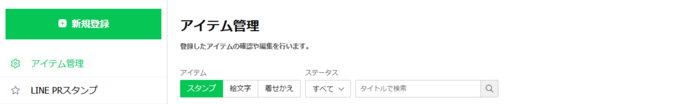

次の画面で「スタンプ」を選びます。

## 2　タイプと表示情報を入力

静止画のセットでは、スタンプのタイプに「スタンプ」を選びます。画像の枚数は、後のスタンプ編集画面で設定します。

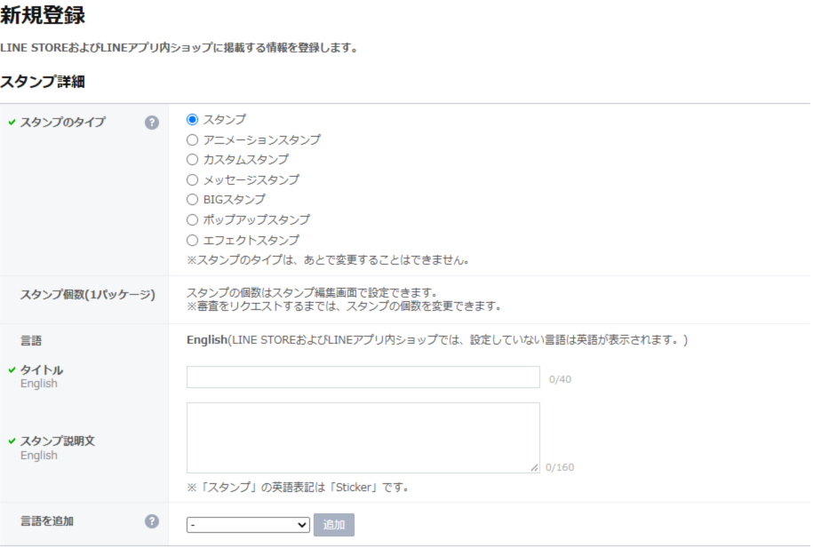

1. Englishのタイトルとスタンプ説明文に、確定した英語の文面を入力します。
2. 日本語でも掲載する場合は「言語を追加」で日本語を追加します。
3. 追加した言語のタイトルと説明文も入力します。
4. 入力欄の文字数表示と、保存時の検証結果を確認します。

画像は入力前の状態です。実際の登録では、確定した文面を入れてください。タイトル・説明文・キャラクター名の表記が、制作時の取り決めと一致しているか確認します。

## 3　販売情報と開始方法を確認

同じ登録フォームを下へ進むと、販売情報の項目があります。

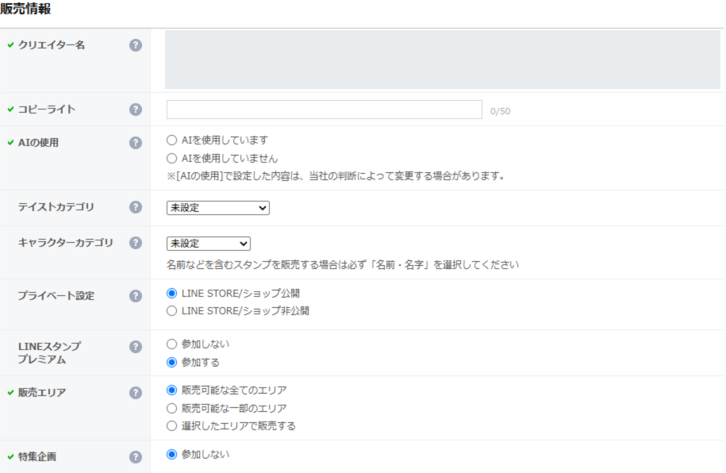

| 項目 | 確認する内容 |
|---|---|
| クリエイター名 | アカウントに設定された表示名を確認する。画像では固有情報を伏せている |
| コピーライト | 制作時に確定した表記を、入力条件に合わせて設定する |
| AIの使用 | 制作の実態に合わせて設定する。本プロジェクトでAI生成素材を使用した作品は、その使用を申告する |
| テイスト・キャラクターカテゴリ | 作品の内容に合う選択肢を選ぶ |
| プライベート設定 | ショップでの公開範囲を、利用目的に合わせて選ぶ |
| LINEスタンプ プレミアム | 参加するか、画面の説明を読んで決める |
| 販売エリア | 販売したい地域と、適用される条件を確認する |
| 特集企画 | 参加する場合は、対象作品・受付期間・価格・販売エリアなどの条件を確認する |

「AIの使用」の意味と設定方法は、[公式ヘルプ](https://help2.line.me/creators/web/categoryId/20002312/3/pc?contentId=200001335&lang=ja)で確認できます。

さらに下には、スタンプアレンジ機能、コラボレーション、お試し送信キャンペーンなどの選択肢があります。表示された初期値をそのまま確定せず、各項目の説明に沿って選びます。

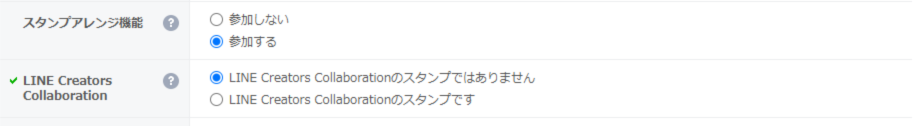

販売開始設定は、承認後の操作を左右します。

- **手動で販売を開始**：承認後、ユーザーが販売開始の操作を行う方式。
- **自動で販売を開始**：承認後に自動で販売を始める方式。参加キャンペーンに開始日の指定がある場合は、その条件を確認する。

写真の使用やライセンス証明の項目も実際の制作内容に合わせて確認し、必要な資料を用意します。入力内容を確認して「保存」を押します。

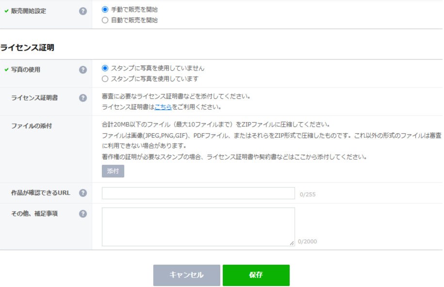

販売開始設定の詳細は、[公式の販売ヘルプ](https://help2.line.me/creators/web/categoryId/20002318/3/pc?contentid=20005124&lang=ja)を参照してください。

## 4　画像をアップロード

保存後のアイテム管理画面で「スタンプ画像」タブを開き、下部の「編集」を押します。

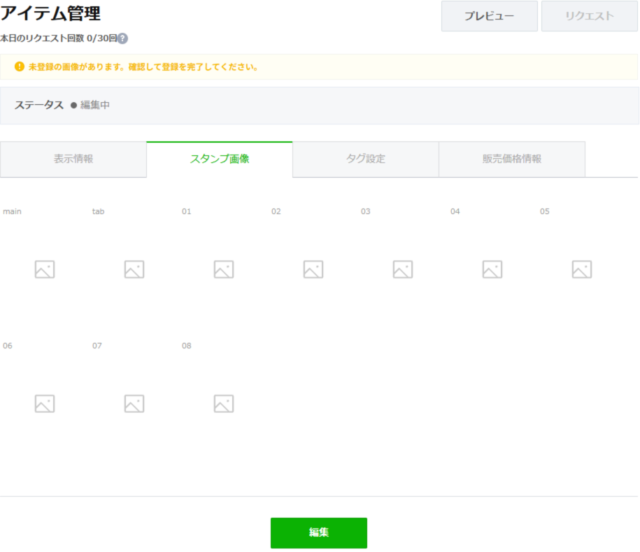

スタンプの編集画面で、次の順に登録します。

1. 「スタンプ個数」の選択欄を、制作したセットの枚数に合わせます。
2. 「ZIPファイルアップロード」を押し、作品の `output/upload.zip` を選びます。
3. アップロード結果とエラー表示を確認します。
4. Main、Tab、すべてのスタンプが正しい枠へ入り、予定した順序になっているか確認します。
5. 画面の背景色を切り替えて、透過や白い縁の見え方も確認します。

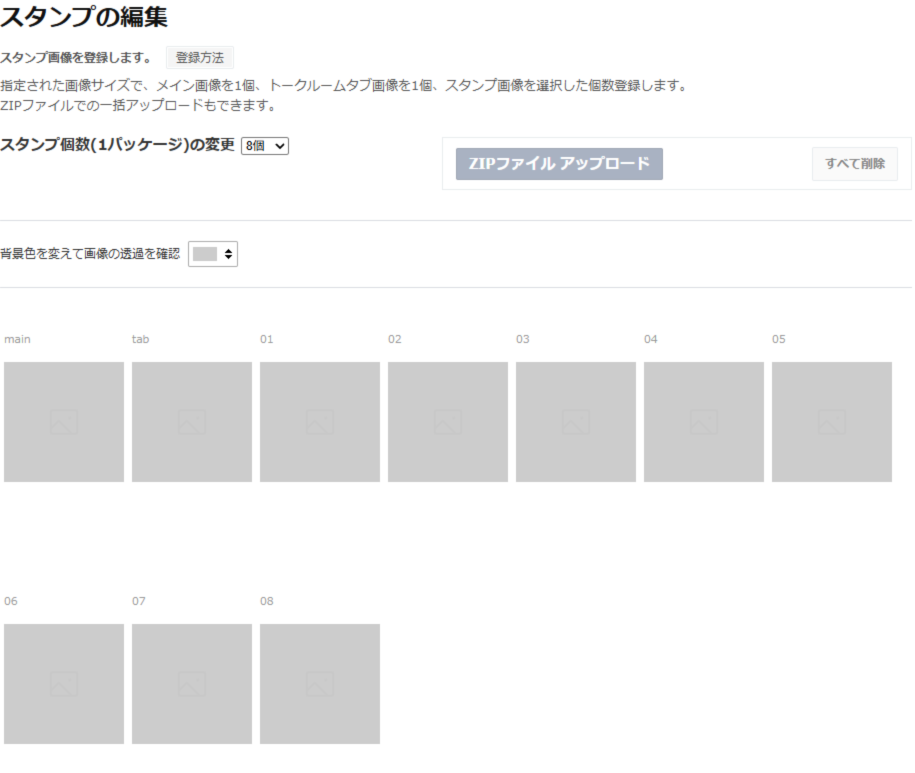

画像例の「8個」は画面撮影時の値です。制作したセットが24点なら24個など、作品と一致する枚数を選びます。MainとTabはスタンプ本体の個数には含めません。

| 登録枠 | アップロード用ファイル |
|---|---|
| main | `main.png` |
| tab | `tab.png` |
| 01以降 | `01.png`、`02.png`などの連番 |

上の静止画像はアップロード前の枠を示しています。アップロード後に画像が並ぶ様子は、[制作手順書の工程17](workflow.html#step-17)のGIFで確認できます。空欄がなく、エラーも解消していることを実際の画面で確認してください。

## 5　タグを設定

アイテム管理の「タグ設定」タブを開き、各スタンプの「編集」からタグ候補を選びます。作品の `output/tags.txt` は、適切な候補を探すための手元資料です。

1. 対象のスタンプを選びます。
2. セリフや感情に合う候補を検索・選択します。
3. 各スタンプについて、意味が合っているか確認します。

1点につき設定できるタグは最大9個です。枠を埋めるために無関係なタグを付けず、表示された候補から選んでください。設定方法と保存の扱いは[LINE公式のタグ設定ガイド](https://note.com/line_cm/n/n846009d35f27)を参照してください。

タグ候補を選び、検索して追加する操作は、[制作手順書の工程18](workflow.html#step-18)のGIFで確認できます。この節のタグ上限と保存の扱いは、上記の公式情報も照合しています。

## 6　販売価格を設定

「販売価格情報」タブを開き、希望する価格を選んで「保存」を押します。

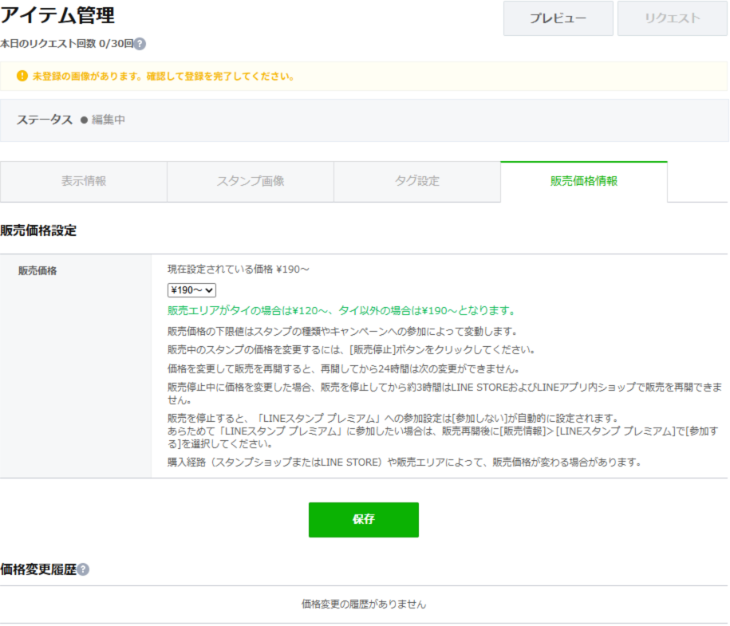

画像の価格は撮影時の例です。販売エリア、スタンプの種類、参加企画などにより条件が変わるため、現在の選択肢と注意書きを確認してください。[公式の販売価格の案内](https://help2.line.me/creators/web/categoryId/20002318/3/pc?contentid=20005124&lang=ja)

## 7　プレビューして審査リクエスト

「プレビュー」で表示を確認し、次の項目を一つずつ照合します。

- 言語ごとのタイトル・説明文と名前表記が正しい。
- AIの使用、公開範囲、販売エリア、価格、販売開始方法が希望どおり。
- Main・Tabと全スタンプが登録され、枚数と並び順が正しい。
- 文字が読め、意図しない背景や透過漏れ、見切れがない。
- 設定したタグが、各スタンプの内容に合っている。
- キャンペーンへ参加する場合は、その条件を満たしている。

確認できたら、右上の「リクエスト」を押します。

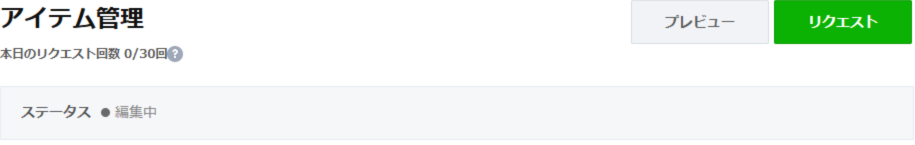

確認画面の説明と同意事項を読み、内容を確認した上で「同意します」にチェックし、「OK」を押します。この操作で審査を申請します。

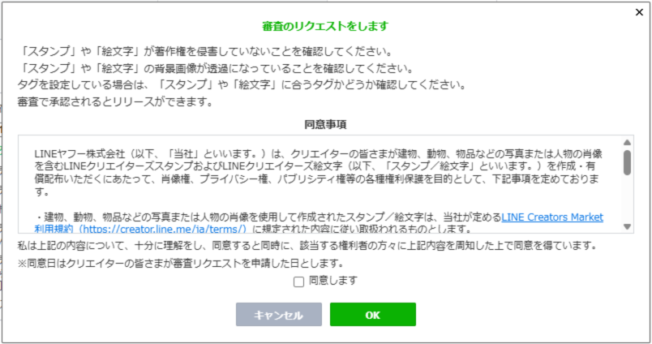

## 8　審査待ちを確認

申請後は、ステータスと申請済みの案内を確認します。画像は「審査待ち」の例です。

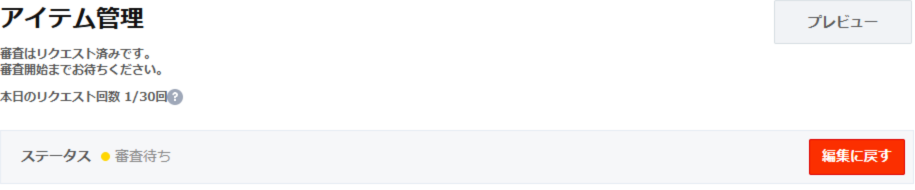

審査待ちは販売開始とは別の段階です。結果を確認し、修正の案内があれば対応します。

## 9　承認後に販売開始

登録時に選んだ販売開始設定に応じて進めます。

| 販売開始設定 | 承認後の流れ |
|---|---|
| 手動で販売を開始 | アイテム管理で対象作品を開き、「リリース」から販売を開始する |
| 自動で販売を開始 | 承認後に自動で販売が始まる。開始日指定のキャンペーンは、その条件に従う |

この承認後の画面は未収録です。上の分岐は[公式ヘルプ](https://help2.line.me/creators/web/categoryId/20002318/3/pc?contentid=20005124&lang=ja)に基づきます。販売開始後は、作品の販売ページでタイトル、説明、Main、全画像、価格の表示を確認します。

## 画面例について

画面例は2026-11-02時点の操作を示しています。枚数・価格・参加設定は、あなたの作品に合わせて選んでください。初回クリエイター登録と承認後の販売開始の画面例は未収録のため、各項目の公式情報も参照してください。

ボタン名や入力条件が変わった場合は、現在の実画面と公式情報を優先してください。[制作ガイドライン](https://creator.line.me/ja/guideline/sticker/)と[公式の全体フロー](https://creator.line.me/ja/howto/)も合わせて確認できます。
