# GIFで見るLINEスタンプ制作

参考画像を用意し、Codexと相談しながらスタンプを作る手順です。セットアップや書き出しはCodexに頼み、あなたは希望を伝えてデザインを確認します。

**準備 → 参考画像と企画 → サンプル → 全体制作 → 個別調整 → PNGとZIP → LINEへの登録**

[ブラウザ版を開く](workflow.html)と、見たい工程のGIFを1本ずつ再生・停止できます。このMarkdown版では、各工程の画像を押すとGIFを開きます。

操作例は2026-11-02に収録したmacOSの画面です。待機時間を省いています。動画内のキャラクター、8点の構成、セリフ、価格は一つの制作例なので、あなたの作品に合わせて決めてください。Windows・Linuxでは、フォルダ選択や権限設定の画面が異なります。

## はじめる前の準備

画像生成ツールが有効で、ファイル操作とコマンド実行ができるCodexを使います。VectorCraftを表示できるデスクトップ環境と、初回セットアップ用のネットワーク接続も必要です。詳しい環境条件は[セットアップ](setup.md)を参照してください。

あなたが使用できるキャラクター画像を用意します。キャラクターの設定や、変えてほしくない特徴があれば一緒に伝えます。

<nav class="guide-nav" aria-label="制作手順へのリンク"><a href="#step-01">01–04 準備</a><a href="#step-05">05–06 企画</a><a href="#step-07">07–10 制作</a><a href="#step-11">11–13 調整</a><a href="#step-14">14–15 出力</a><a href="#step-16">16–20 登録</a></nav>

## 01　作業フォルダの用意

制作に使う保存先を決めます。リポジトリを取得済みなら、そのフォルダをそのまま使えます。まだ取得していない場合は、工程03でCodexに取得先のURLと保存先を伝えます。

**確認すること：** 後で開き直せる場所になっていること。既存の作品があるフォルダを、空の作業場所として作り直さないこと。

[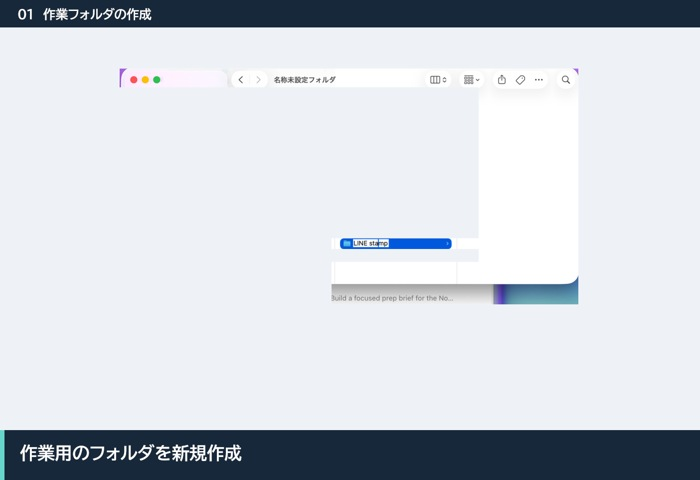](assets/workflow/01_作業フォルダの作成.gif)

## 02　Codexでフォルダを開く

Codexで新しいプロジェクトを作り、作業フォルダを選びます。フォルダを信頼するか聞かれたら、選んだ場所を確認して進めます。

**確認すること：** プロジェクト名とソースフォルダが、今回の制作に使うものと一致していること。

[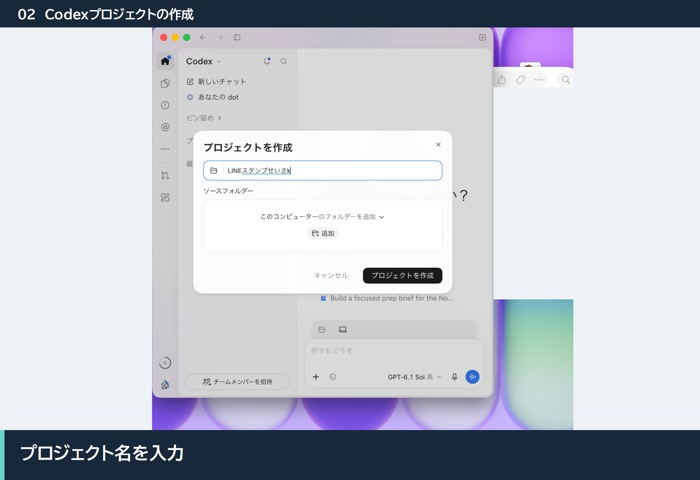](assets/workflow/02_Codexプロジェクトの作成.gif)

## 03　セットアップの依頼

未取得ならこのリポジトリのGitHub URLを伝え、取得とセットアップをCodexに依頼します。取得済みのフォルダを開いた場合は、そのまま次のように伝えます。

> このリポジトリをセットアップしてください。参考画像からLINEスタンプを作りたいです。まずサンプル1点から進めてください。

必要な環境はCodexが確認します。すでに使えるVectorCraftがあれば、その場所も伝えます。リポジトリを開いただけで準備が完了するわけではないので、セットアップ完了の報告まで確認します。

[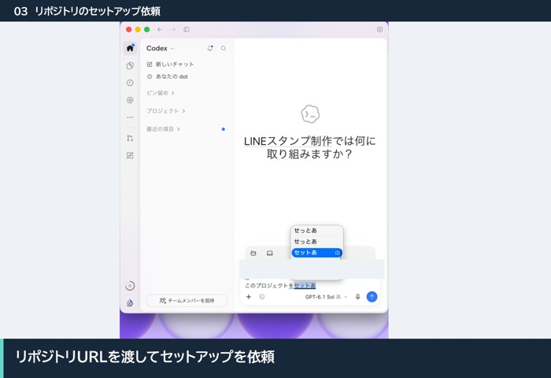](assets/workflow/03_リポジトリのセットアップ依頼.gif)

## 04　権限と起動の確認

画面操作などの権限を求められた場合は、用途と対象アプリを確認します。設定後、VectorCraftのウィンドウが表示され、日本語が正しく表示できることを確認します。

画面が出ない場合は、Codexに「VectorCraftの画面が表示されていません」と伝えます。WSL2を使う場合は、そのことも伝えてください。

[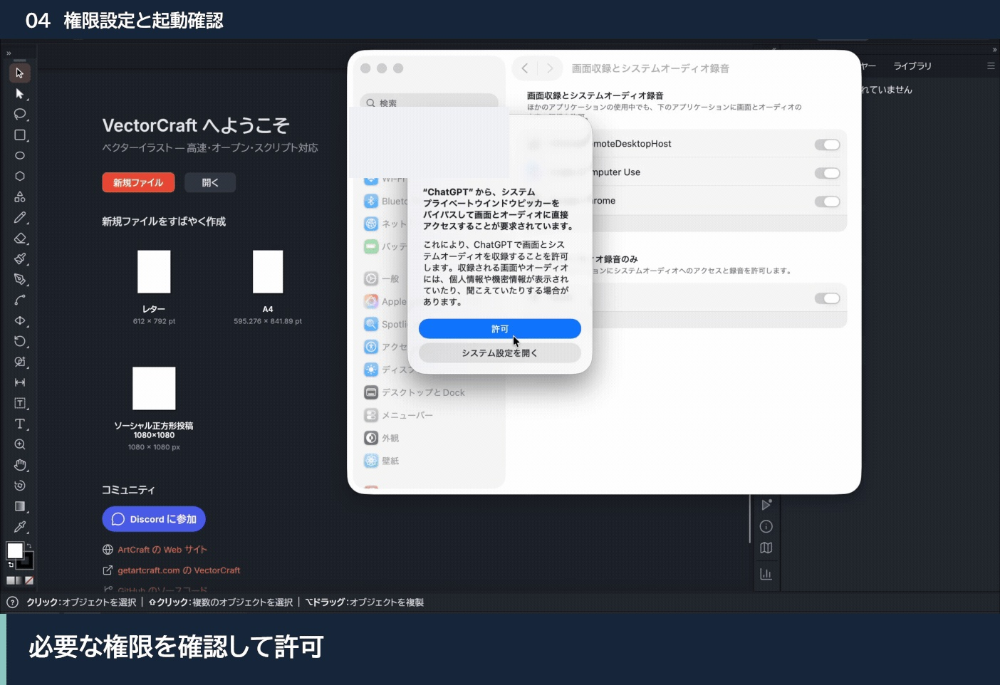](assets/workflow/04_権限設定と起動確認.gif)

## 05　参考画像と希望の共有

作業フォルダの `input/references/` に参考画像を置き、Codexに知らせます。別の場所にある画像のパスを伝えて、取り込んでもらうこともできます。

> 参考画像を置きました。このキャラクターで、友だちにも仕事相手にも使いやすい丁寧なスタンプを作りたいです。顔・配色・体型・衣装を元画像に合わせてください。

Codexが元画像を見てから制作を始めます。左右で異なる衣装や小物がある場合は、左右も維持するよう伝えます。元の参考画像は保持し、作品ごとにもコピーを保存します。

[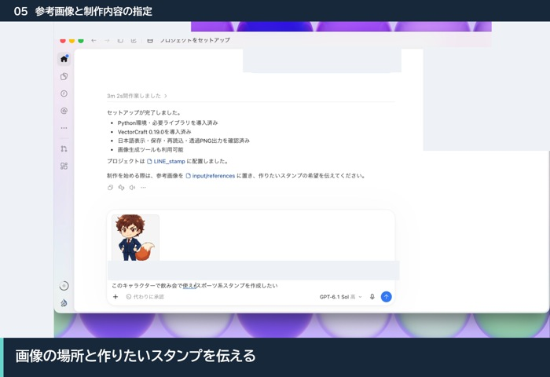](assets/workflow/05_参考画像と制作内容の指定.gif)

## 06　枚数とセリフの決定

誰に、どんな場面で使いたいかを伝え、枚数・口調・セリフ・掲載順を相談します。枚数は制作時点の[LINE公式ガイドライン](https://creator.line.me/ja/guideline/sticker/)に合わせて決めます。

質問には「？」を付けるなど、約物も確認します。「！」は伝えたい気持ちに合わせて使います。日本語・英語の名前表記、タイトルと説明の候補・確定の区別も記録していきます。

**確認すること：** 日常で使う場面が浮かぶこと、希望した口調であること、セリフが勝手に短縮されていないこと。

[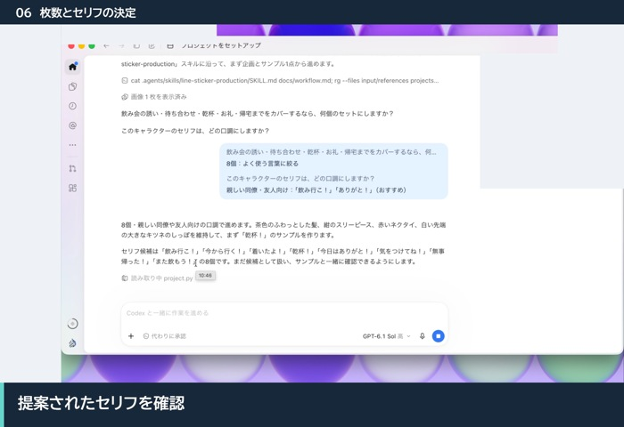](assets/workflow/06_枚数とセリフの決定.gif)

## 07　原画とサンプルの確認

Codexが参考画像を基に、文字なし・背景透過の原画を生成し、作品フォルダの `artwork/` に保存します。その後、VectorCraftで文字や装飾を重ね、代表サンプルを作ります。

顔・髪・体型・衣装・配色・左右・手指・見切れ・透過を元画像と比べます。原画に不要な文字やロゴ、透かし、後から付ける装飾が焼き込まれていないことも確認します。問題があれば、全体制作へ進む前に修正を頼みます。

制作中のキャンバスは基本1:1とし、提出用PNGは後で登録仕様に合わせます。顔アップなどへのトリミングは、表情やポーズが伝わるかを見て決めます。

[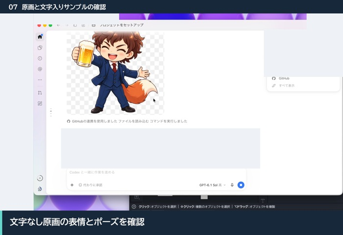](assets/workflow/07_原画と文字入りサンプルの確認.gif)

## 08　サンプルの承認

サンプルの方向性がよければ、その方針で残りの制作を依頼します。

> この方向で進めてください。各セリフの感情やポーズに合わせて、フォント・色・文字の位置は変えて構いません。

サンプルで決めるのはデザインの判断基準です。全点を同じ座標・書体・配色に固定するテンプレートとしては扱いません。ブランド規定がある場合も、今回どこまで適用するかを伝えます。

[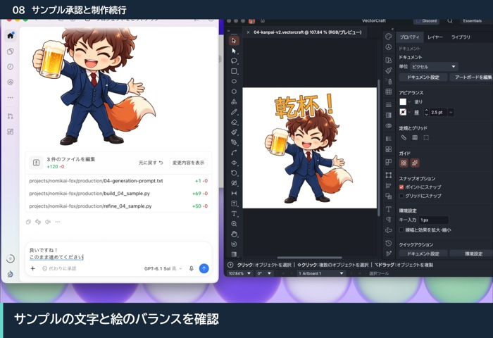](assets/workflow/08_サンプル承認と制作続行.gif)

## 09　セット全体の見比べ

全体を並べた画像で、同じキャラクターに見えるか、表情・ポーズ・構図に変化があるかを確認します。各スタンプが伝える感情は一つに絞り、使う頻度や相手から見た向きも考えて並び順を決めます。

よく使うセリフは探しやすい位置へ置きます。MainとTabも、それぞれの用途に合う顔の大きさや文字の有無を決め、確認対象に含めます。

[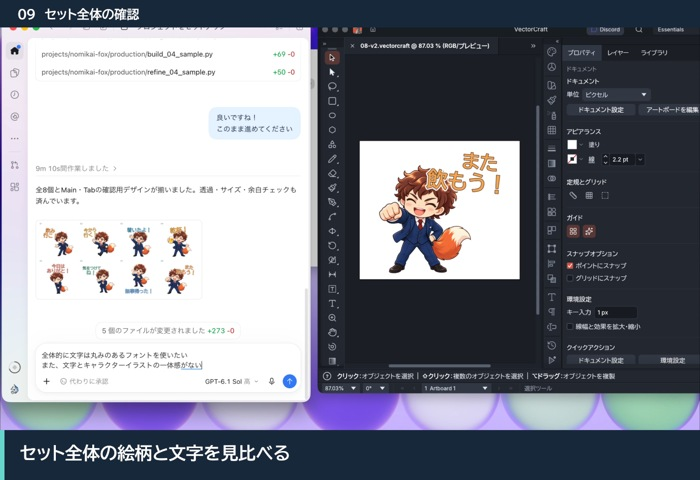](assets/workflow/09_セット全体の確認.gif)

## 10　書体と文字配置の修正

直したい箇所は、画像番号と希望を具体的に伝えます。

> 02は手書き風の太めの書体にしてください。文字をもう少し大きくして、2行の間隔を詰めたいです。キャラクターとの重なりも使って、絵と文字に一体感を出してください。

文字は毎回足元へ押し出さず、上部・下部・吹き出し・斜め・曲線・縦書きなどから選びます。キャラクターとの重なりは使ってよく、可読性と表情の伝わり方で判断します。明暗どちらの背景でも読める色や縁取りを使います。

[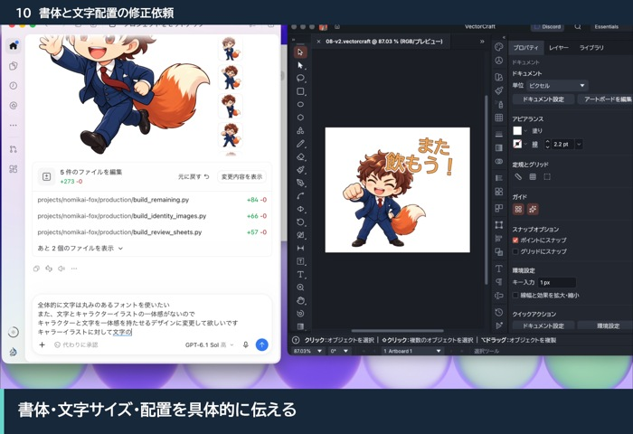](assets/workflow/10_書体と文字配置の修正依頼.gif)

## 11　確認する単位の指定

一つずつ微調整するため、開いてもらう枚数を決めます。

> 4点ずつ確認します。まず最初の4点を、1スタンプ1ファイルで別々のタブに開いてください。終わったら報告します。

4点は確認単位の例です。自分が見比べやすい枚数を指定できます。開いている無関係な文書や、未保存の編集がある文書を勝手に閉じないよう進めます。

[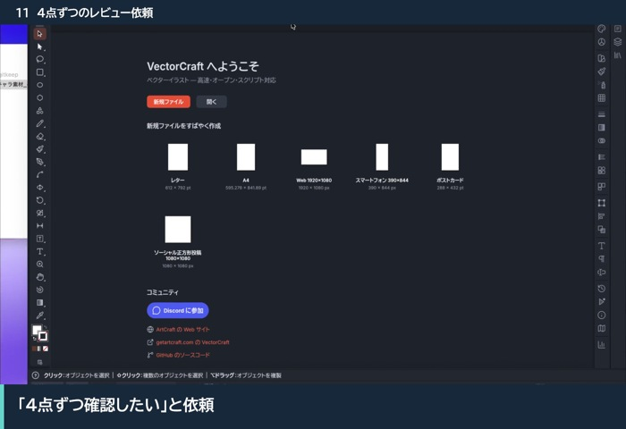](assets/workflow/11_4点ずつのレビュー依頼.gif)

## 12　VectorCraftで微調整

文字グループを選んで、位置・大きさ・行間を調整します。自分で動かしても、Codexに修正を頼んでも構いません。

語句ごとに文字本体と内外の縁取りがまとまっていれば、一緒に動かせます。縁取りの色別に別の語句までまとめられている場合は、語句単位に直してもらいます。文字とキャラクター、装飾は分けて編集できる状態にします。

縮小したときにセリフが読めるか、顔やポーズの印象が伝わるかを見ます。1点につき1つの `.vectorcraft` ファイルに保存します。

[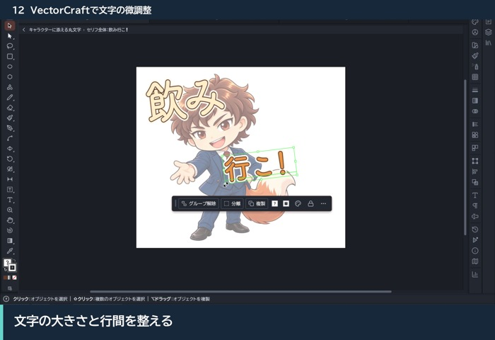](assets/workflow/12_VectorCraftで文字の微調整.gif)

## 13　完了報告と次のセット

現在の確認単位を調整し終えたら、Codexに伝えます。

> 最初の4点の調整が完了しました。変更を保存して、次の4点を開いてください。

Codexが変更を保存して確認の記録を残し、次の単位へ進みます。全点とMain・Tabの確認が終わるまで繰り返します。確認後にデザインやセリフが変わった場合は、変更後の内容をもう一度確認します。

[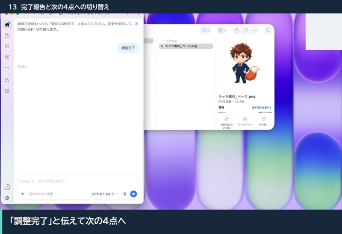](assets/workflow/13_完了報告と次の4点への切り替え.gif)

## 14　PNGと登録用ZIPの受け取り

> 全点の調整が完了しました。最新版から透過PNG、Main・Tab、LINE登録用ZIP、タグ検索候補、検証記録を用意してください。

Codexが確認済みの編集ファイルから出力します。現行の[LINE公式仕様](https://creator.line.me/ja/guideline/sticker/)を確認し、寸法、透過、容量、余白、解像度、フォントを検査します。明暗両背景と実寸でも最終PNGを目視します。出力が変わった場合は、新しい画像を再確認します。

2026-11-02に確認した[LINE公式仕様](https://creator.line.me/ja/guideline/sticker/)では、Mainは240×240px、Tabは96×74px、スタンプ本体は最大370×320pxのPNGです。編集用の正方形キャンバスと、登録用の寸法を混同しないでください。

受け取る場所は `projects/<作品名>/output/` です。`upload.zip` はスタンプ本体とMain・TabのPNGだけを含みます。`tags.txt` と検証記録は別に受け取り、ZIPの枚数・連番・内容も確認します。

[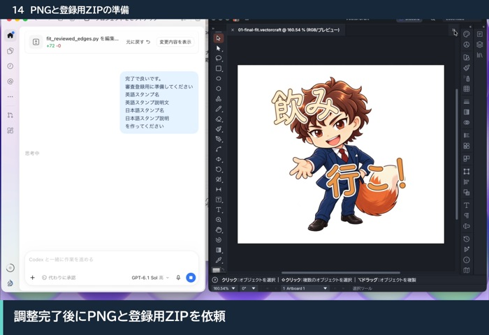](assets/workflow/14_PNGと登録用ZIPの準備.gif)

## 15　登録する文面の確定

日本語・英語のキャラクター名、タイトル、説明文を最終確認します。候補のまま残っている文面があれば、この段階で決めます。

> 登録に使うタイトルと説明文を、日本語・英語でまとめてください。キャラクターの名前表記を統一し、文字数も確認してください。

作品フォルダのファイル名だけで判断せず、登録画面へ入力する確定文面を使います。動画内の名前やタイトルは制作例です。

[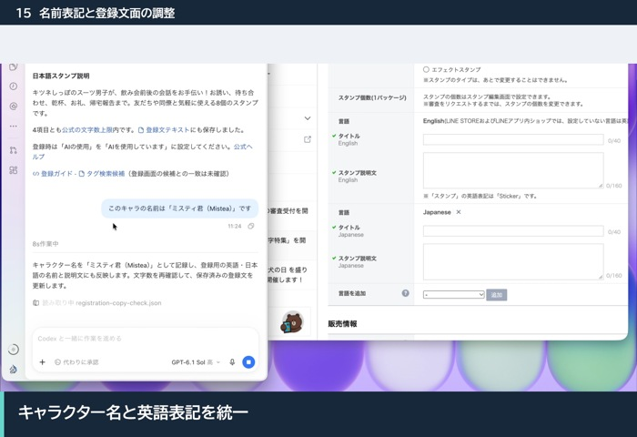](assets/workflow/15_名前表記と登録文面の調整.gif)

## 16　LINEの表示情報と販売情報

[LINE Creators Market](https://creator.line.me/ja/)へログインし、新規登録から「スタンプ」を選びます。初めて使う場合は、先に[クリエイター登録](registration.md#account)を済ませます。

確定した英語のタイトル・説明文を入力し、日本語でも掲載する場合は言語を追加します。クリエイター名、コピーライト、公開範囲、販売エリア、販売開始方法なども、自分の希望と制作内容に合わせて設定します。

「AIの使用」は制作の実態に合わせて申告します。AI生成素材を使った作品では、その使用を設定します。[公式ヘルプ](https://help2.line.me/creators/web/categoryId/20002312/3/pc?contentId=200001335&lang=ja)と、[登録ガイドの詳しい説明](registration.md#details)も確認できます。

[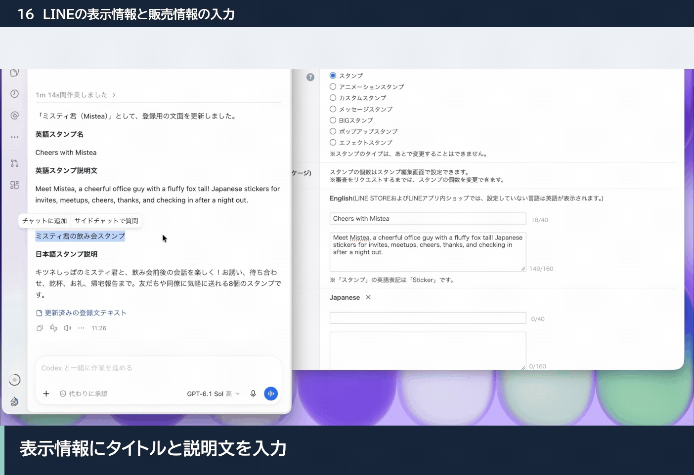](assets/workflow/16_LINEの表示情報と販売情報の入力.gif)

## 17　登録用ZIPのアップロード

「スタンプ画像」タブから編集画面を開き、スタンプ個数を作品の枚数に合わせます。「ZIPファイルアップロード」から `output/upload.zip` を選びます。

**確認すること：** Main・Tabと全スタンプが正しい枠に入り、空欄やエラーがないこと。枚数と並び順が予定どおりで、背景色を切り替えても透過や文字の縁が正しく見えること。

詳しい画面の見方は[画像アップロードの説明](registration.md#images)を参照してください。

[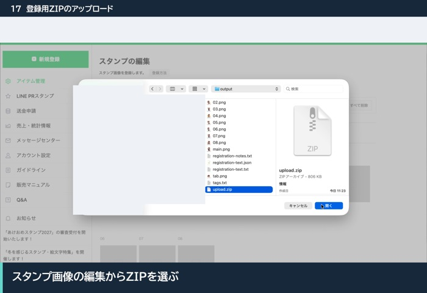](assets/workflow/17_登録用ZIPのアップロード.gif)

## 18　各スタンプのタグ設定

「タグ設定」から各スタンプの「編集」を開き、絵やセリフに合う候補を選びます。`output/tags.txt` は検索語を探すための手元資料として使います。

一覧に合う候補がなければ検索します。検索語と登録できるタグは同じとは限らないので、実際に表示される候補から意味が合うものを選びます。最大9個の枠を埋める必要はありません。[LINE公式のタグ設定ガイド](https://note.com/line_cm/n/n846009d35f27)も参照できます。

[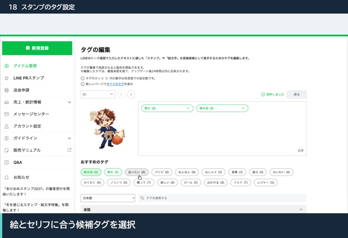](assets/workflow/18_スタンプのタグ設定.gif)

## 19　販売価格の確認

「販売価格情報」タブを開き、表示される選択肢から価格を選んで保存します。参加する企画がある場合は、その条件も確認します。

動画内の価格へ合わせる必要はありません。自分の作品の販売条件と、現在の画面の注意書きを確認してください。[価格設定の説明](registration.md#price)も参照できます。

[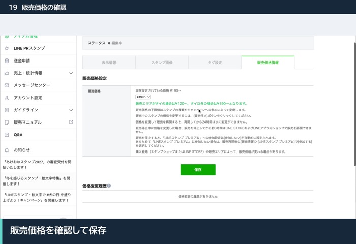](assets/workflow/19_販売価格の確認.gif)

## 20　審査リクエストと審査待ち

プレビューで、タイトル・説明文・画像・タグ・販売設定を最終確認します。問題がなければ「リクエスト」を押し、説明と同意事項を読んでから申請します。

申請後に「審査待ち」と表示されることを確認します。審査待ちは販売開始とは別の段階です。承認後は、選んだ販売開始方法に従って進めます。詳しくは[審査申請](registration.md#request)と[承認後の販売開始](registration.md#release)を参照してください。

このGIFは審査待ちまでを収録しています。初回クリエイター登録と承認後の販売開始の操作画面は含みません。

[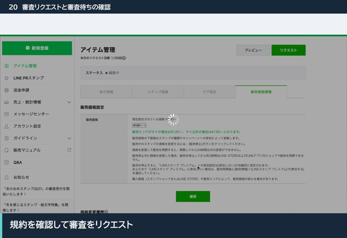](assets/workflow/20_審査リクエストと審査待ちの確認.gif)

## 途中から再開する場合

同じ作業フォルダをCodexで開き、次のように伝えます。

> 前回の作品の続きから進めてください。保存済みの画像と編集ファイルを確認し、未完了の工程から再開してください。

作品の設定、進行記録、実際のファイルを照合して続きへ進みます。参考画像や調整済みのデザインを、理由なく作り直す必要はありません。

詳しい登録画面は[スクリーンショット付き登録ガイド](registration.html)、保存するデータは[READMEの保存先と再開方法](../README.md#保存先と続きからの再開)で確認できます。
